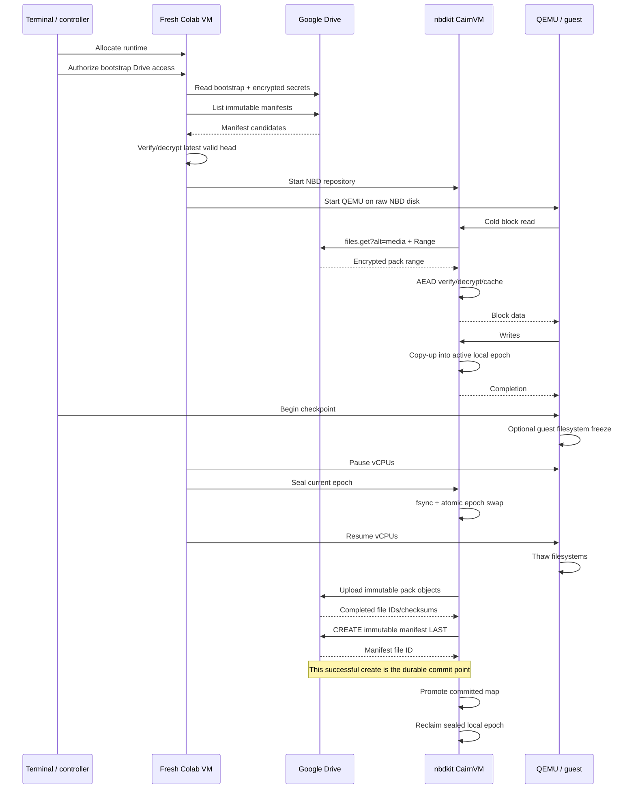

# CairnVM: Persistent Virtual Disks on Ephemeral Compute (Historical Draft)

> **Historical and non-normative:** This superseded draft is retained for design
> history only. Do not implement from it; `Docs/Architecture-Spec.md` governs
> CairnVM. Names have been updated to the current identity, but this architecture
> may otherwise be obsolete.

## Executive summary

The technically best architecture under the stated constraints is **not** a qcow2 image mounted directly from Google Drive, a writable rclone mount, or a restic snapshot restored wholesale at startup. It is a **custom, immutable, versioned block store implemented on top of Google Drive blob files, presented to QEMU through NBD/nbdkit, with all hot reads and writes cached on the ephemeral Colab filesystem**.

The architecture is:

```text
                         DURABLE STATE
                    ┌─────────────────────┐
                    │    Google Drive     │
                    │                     │
                    │ immutable packs     │
                    │ immutable manifests │
                    │ encrypted secrets   │
                    └──────────┬──────────┘
                               │
                 Drive REST API│
             Range GET / resumable PUT
                               │
                               ▼
┌──────────────────────────────────────────────────────┐
│                EPHEMERAL COLAB RUNTIME               │
│                                                      │
│  /content/cairnvm/                                   │
│    cache.raw        decrypted read cache             │
│    active.raw       current COW epoch                │
│    sealed.*.raw     checkpoint epochs being uploaded │
│                                                      │
│             ┌───────────────────────┐                │
│             │ CairnVM nbdkit plugin │                │
│             │                       │                │
│             │ Drive API client      │                │
│             │ COW / cache engine    │                │
│             │ encryption            │                │
│             │ checkpoint engine     │                │
│             └──────────┬────────────┘                │
│                        │ NBD                         │
│                        ▼                             │
│             ┌───────────────────────┐                │
│             │         QEMU          │                │
│             │ virtio-blk raw disk   │                │
│             └──────────┬────────────┘                │
│                        │                             │
│                     guest OS                         │
└──────────────────────────────────────────────────────┘
```

All durable VM state resides in Drive. `/content` is deliberately disposable: it is only a read cache, current write-back overlay, and staging area. A completely new Colab VM can reconstruct the logical disk solely from Drive plus user authentication. Google itself warns that Drive-mounted files may be geographically distant from a Colab runtime and recommends minimizing Drive reads/writes and avoiding workloads made of many small accesses; consequently, letting a guest filesystem perform live 4 KiB random I/O against DriveFS is almost the worst possible design.

The durable disk should consist of **256 KiB logical COW chunks packed into approximately 256 MiB immutable Drive files**. A compact encrypted manifest maps each 256 KiB logical block to `(Drive file ID, byte offset, encrypted-record length)`. The 256 KiB logical granularity limits write amplification from small guest writes, while large pack files keep Drive file counts and upload operations low. Drive supports byte-range downloads, so an individual encrypted record can be fetched without downloading its containing 256 MiB pack; sequential reads can be coalesced into multi-megabyte ranges.

A checkpoint is committed with a **packs-first, manifest-last transaction protocol**:

1. Momentarily establish a block-device snapshot boundary.
2. Atomically seal the current local COW epoch and immediately open a fresh local epoch.
3. Resume the guest.
4. Compress/encrypt dirty chunks and upload new immutable pack files.
5. Verify the uploads.
6. Create one new immutable manifest referencing those packs.
7. Only successful creation of that final manifest constitutes a durable checkpoint.

There is no mutable `latest` file and no in-place modification of existing disk objects. If Colab dies before step 6, the previous manifest remains authoritative; partially uploaded or completed-but-unreferenced packs are garbage. If it dies after step 6, the new checkpoint is complete. This converts Drive's ordinary file API into a transactional-enough snapshot store without requiring a cross-file atomic transaction that Drive does not provide. Drive exposes file size and server-generated SHA-256 metadata for binary files, which can be incorporated into upload verification.

The NBD layer should be implemented initially as an **nbdkit Python plugin**, because nbdkit explicitly exposes `pread`, `pwrite`, `flush`, `trim`, `zero`, `cache`, FUA handling, extent reporting, and parallel request models to Python plugins. HTTP requests can overlap despite Python's GIL because callbacks blocked in network libraries allow other callbacks to execute. Once profiling demonstrates that Python CPU overhead is material on cache hits, the storage engine—not its Drive format—can be rewritten in Rust or C without changing the disk repository.

For the guest, use **QEMU with KVM when `/dev/kvm` is actually exposed**, and otherwise QEMU TCG. Colab does not document nested KVM as an available or stable runtime feature, so availability must be probed on every allocation. QEMU's TCG is its general software-emulation accelerator and supports multithreaded vCPU execution where supported. UML is worth benchmarking only as a Linux-specific TCG alternative; it should not define the storage architecture because it sacrifices guest portability.

The design deliberately provides **checkpoint durability rather than remote durability for every guest `fsync()`**. Guest flushes make writes safe on the surviving Colab runtime's `/content` storage; a Colab-runtime disappearance can lose everything since the last committed Drive checkpoint. Making every guest flush synchronously create Drive durability would turn ordinary filesystem journaling into HTTP uploads and destroy steady-state VM performance. The default checkpoint interval should therefore be selected according to the required recovery-point objective—five minutes is a sensible starting policy, not a Google guarantee.

Authentication should use a **dedicated Google OAuth client ID**, not rclone's shared Drive client. As of August 2026, rclone explicitly states that its shared Drive client ID is being retired during 2026 and that users should create their own. Google recommends using standard OAuth libraries and minimizing requested scopes.

The resulting recommendation, in one sentence, is:

> **Build a raw virtual disk over nbdkit whose durable blocks are independently encrypted 256 KiB records inside immutable ~256 MiB Google Drive pack files, maintain a full immutable encrypted mapping manifest per checkpoint, keep a sparse local COW/cache layer in `/content`, checkpoint by epoch-swap followed by pack uploads and manifest-last commit, and run QEMU/KVM with automatic TCG fallback.**

That is the design I would implement if the objective is the best persistent VM architecture rather than the least code.

## Decision matrix and architectural rationale

There are four serious candidate designs. The most obvious one—putting `disk.qcow2` directly under `/content/drive/MyDrive`—is also the least appropriate. Colab's own FAQ says Drive access can be slowed by distance between runtime and Drive storage and explicitly recommends reducing small reads/writes; rclone similarly needs a substantial local VFS layer to emulate ordinary filesystem semantics over Drive.

| Architecture | Cold boot | Hot I/O | Checkpoint atomicity | Upload efficiency | Crash recovery | Implementation | Verdict |
|---|---|---|---|---|---|---|---|
| **Writable qcow2 directly on DriveFS/rclone** | Apparently simple | **Bad**: remote random I/O and metadata traffic | Weak/awkward because one mutable remote file is continually changing | Poor | Dependent on remote mount/writeback state | Low | **Reject** |
| **Local qcow2 + immutable Drive qcow2 overlays** | Moderate; lower layers must be fetched/lazily cached | Good while top overlay is local | Can be made good by publishing completed overlays immutably | Reasonable, but includes qcow2 metadata and layer-chain overhead | Good with manifest-last scheme | Medium | **Best simple prototype, not end-state** |
| **Local disk restored/checkpointed with restic** | Requires materializing much or all of disk before useful boot | Excellent after restore | Restic's immutable snapshot model is strong | Excellent dedup for backup workloads | Strong | Low/medium | **Excellent backup system, poor live block backend** |
| **Packed chunk store + NBD + local COW cache** | **Best potential**: demand-fetch working set only | **Best**: hot I/O local | **Strong**: immutable objects + manifest-last commit | **Best controllable block-level incrementality** | **Strong and explicit** | High | **Recommended** |

Restic remains useful for the source code, configuration bundle, logs, and perhaps exported guest backups, but a backup repository solves a different problem from a demand-paged virtual block device. Restic's pack-based, deduplicating repository and snapshot model are optimized for backups; pruning is a separate repository-management operation and can be expensive.

A qcow2-overlay design is much better than a writable Drive image. Qcow2 supports backing files and copy-on-write semantics specifically suitable for immutable base + writable overlay chains. A local top-level qcow2 and read-only remote lower layers therefore form a respectable v0 prototype, especially combined with rclone's `--vfs-cache-mode full`, which uses sparse local files and downloads only requested portions.

It is nevertheless inferior to the custom NBD design for a long-lived machine:

* qcow2 introduces a second copy-on-write metadata system even though our remote store already needs one;
* reads can require qcow2 metadata traversal before reaching remote data;
* long backing-file chains increase lookup cost and operational complexity;
* flattening the chain eventually entails rewriting a substantial virtual image;
* Drive remains unaware of useful logical block boundaries;
* remote cache behavior is controlled at file-range rather than VM-block level.

Those are architectural consequences of stacking qcow2 over another copy-on-write object store, rather than limitations Google or QEMU claim.

The custom NBD design instead makes the abstraction boundary exact:

```text
guest filesystem
       │
       ▼
virtio block requests
       │
       ▼
QEMU raw NBD disk
       │
       ▼
256 KiB CairnVM logical chunks
       │
       ├── current local COW epoch
       ├── pending sealed epoch
       ├── local read cache
       └── immutable Drive pack record
```

Nbdkit is explicitly intended for exposing unconventional data sources as block devices and its Python API contains essentially the callback set this system requires.

**Why raw NBD instead of qcow2 on top of NBD.** The production guest disk should be declared `format=raw`. Qcow2 remains useful only for import/export, such as converting an existing image into CairnVM or exporting a checkpoint for use elsewhere. There should be **no durable qcow2 layer and no qcow2 backing-file chain** in the final architecture.

**Why 256 KiB rather than 4 MiB.** This is one place where the earlier, simpler design can be improved substantially. A 4 KiB guest metadata write landing in a new 4 MiB COW chunk can force as much as 4 MiB of new checkpoint data—a 1024× worst-case amplification. At 256 KiB the corresponding worst-case unit is 64×, while the mapping table remains small enough to store fully at every checkpoint.

For a 64 GiB disk:

\[
\frac{64\ \mathrm{GiB}}{256\ \mathrm{KiB}}
=262{,}144\text{ logical chunks}.
\]

A compact 16-byte mapping entry is therefore only:

\[
262{,}144\times16=4\ \mathrm{MiB}.
\]

At 256 GiB, the uncompressed map is about 16 MiB; at 1 TiB, about 64 MiB. Because adjacent entries tend to share the same pack identifier and similar flags, a compressed binary representation should generally be smaller; the exact compression ratio is workload-dependent and must be benchmarked.

A 256 KiB logical chunk should **not** be confused with Drive's resumable-upload chunk size. Drive requires resumable upload pieces, except the last, to be multiples of 256 KiB and recommends making them large for efficiency. I would use **16 MiB HTTP upload chunks** and **~256 MiB Drive pack objects** even though the logical disk block is 256 KiB.

**Why pack chunks rather than one Drive file per chunk.** Google Drive supports enormous item counts in principle—currently up to 500 million user-created items, and 500,000 items per ordinary My Drive folder—but that does not make hundreds of thousands or millions of tiny files an efficient representation. Pack files reduce directory listings, object creation operations, checkpoint upload sessions, and eventual garbage-collection work while preserving random access through HTTP Range requests. Drive explicitly supports byte-range partial downloads of binary blob files.

**Why not DriveFS for the data plane.** Rclone's VFS full-cache mode is a good fallback because it creates sparse local files and downloads only regions that are actually accessed, but it is still a generic filesystem emulation layer. Rclone also delays remote writeback until cached files are closed and its own documentation warns against overlapping writable VFS caches. A virtual block store benefits from knowing the immutable pack format, logical disk mapping, dirty chunks, snapshot boundaries, and checkpoint semantics explicitly. The custom API client gets to exploit all of that.

The final design thus favors implementation complexity once, in exchange for materially better operational properties for every future VM session.

## Durable block-store design

The durable repository should be deliberately boring: immutable binary blobs, immutable manifests, and as little mutable metadata as possible.

A Drive layout such as the following is sufficient:

```text
CairnVM/
├── bootstrap/
│   ├── cairnvm-src-v1.tar.zst
│   └── secrets.v1.enc
│
├── repository/
│   ├── repo.v1.json
│   │
│   ├── manifests/
│   │   ├── 000000000001-4b2b....cvm1
│   │   ├── 000000000002-0a5f....cvm1
│   │   └── ...
│   │
│   └── packs/
│       ├── 00/
│       │   ├── pack-00f1....cvp1
│       │   └── ...
│       ├── 01/
│       └── ...
│
└── maintenance/
    └── gc-reports/
```

The `packs/xx` sharding is operational hygiene, not part of logical correctness. Although Drive's folder item limits are generous, avoiding a single gigantic folder also makes administrative operations easier.

`repo.v1.json` is created once and contains non-secret geometry:

```json
{
  "format": "cairnvm-repository-v1",
  "repository_uuid": "5064dd2e-0bd2-4dd3-b7f7-7d8248797bf9",
  "virtual_size": 68719476736,
  "logical_chunk_size": 262144,
  "pack_target_size": 268435456,
  "manifest_format": 1,
  "encryption": "xchacha20poly1305",
  "compression": "zstd"
}
```

This file is configuration, not a transaction pointer. Changing disk geometry should require creation of a new repository version rather than silently modifying the current one.

**Pack format.** Every pack is immutable after upload. Conceptually:

```text
┌───────────────────────────┐
│ CVPK pack header          │
│ format/version            │
│ repository UUID           │
│ producing checkpoint UUID │
├───────────────────────────┤
│ record 0 header           │
│ record 0 ciphertext       │
├───────────────────────────┤
│ record 1 header           │
│ record 1 ciphertext       │
├───────────────────────────┤
│ ...                       │
└───────────────────────────┘
```

Each record describes exactly one 256 KiB logical chunk, except the final physical chunk of the virtual disk. A practical record header is:

```text
magic               4 bytes
version             2
flags               2
logical_chunk       8
plaintext_length    4
stored_length       4
nonce              24
reserved / future   ...
ciphertext           stored_length bytes
AEAD tag             included by crypto API
```

Compression happens **per chunk before encryption**, not once across the entire pack. That keeps each record independently range-readable. If zstd compression does not save a meaningful amount—say at least 1–2%—store that chunk uncompressed; that threshold is an implementation choice rather than a protocol requirement.

Each record is then encrypted independently with XChaCha20-Poly1305 using a fresh nonce. Libsodium recommends XChaCha20-Poly1305 when interoperability with other ChaCha variants is not required, and its long nonce makes independent randomly generated nonces practical for this type of object format.

Headers that need not be secret can be supplied to the AEAD primitive as authenticated additional data, so changing a chunk number, lengths, repository UUID, or checkpoint identifier causes authentication to fail.

**Manifest format.** The manifest should be a complete map of the disk at one committed generation, not a chain that must be walked during every read. A human-readable equivalent is:

```json
{
  "format": "cairnvm-manifest-v1",
  "repository_uuid": "...",
  "generation": 42,
  "snapshot_uuid": "...",
  "parent_manifest_id": "...",
  "virtual_size": 68719476736,
  "chunk_size": 262144,

  "packs": [
    {
      "drive_file_id": "1abc...",
      "size": 267892341,
      "sha256": "..."
    },
    {
      "drive_file_id": "1def...",
      "size": 178233119,
      "sha256": "..."
    }
  ],

  "map": [
    ["PACK", 0, 4096, 187213],
    ["PACK", 0, 191309, 251881],
    ["ZERO"],
    ["PACK", 1, 4096, 262176]
  ]
}
```

The real implementation should **not** encode hundreds of thousands of mapping entries as verbose JSON objects. Use a compact binary payload—CBOR or an explicitly specified packed structure—with a pack-ID dictionary and fixed-size entries such as:

```text
uint32 pack_index
uint32 pack_offset
uint32 record_length
uint16 flags
uint16 reserved
```

A special pack index represents all-zero/unallocated chunks.

The entire payload should then be compressed and authenticated/encrypted:

```text
4 KiB clear authenticated header
    magic
    format version
    repository UUID
    generation
    parent Drive file ID
    snapshot UUID
    nonce
    encrypted-payload length

XChaCha20-Poly1305(
    zstd(binary manifest payload),
    additional_data = clear header
)
```

Thus an attacker who can inspect Drive sees that generations and file sizes exist but not the disk block map. Encrypting the outer generation number is possible, but it would force Drive listing clients to download/decrypt every candidate merely to identify the latest generation; exposing generation counters is normally a reasonable metadata tradeoff.

Drive binary-file resources expose `size`, `sha256Checksum`, `headRevisionId`, and a monotonically increasing `version` field. Pack size and SHA-256 should be captured after each successful upload and written into the manifest. AEAD verification remains the authoritative per-record integrity test; Drive's SHA-256 is useful for whole-pack scrubbing and detecting unexpected file replacement.

**Local storage model.** Do not create a local file per remote chunk. Use sparse virtual-size files and compact bitmaps:

```text
/content/cairnvm/
├── cache.raw
├── cache.bitmap
├── epochs/
│   ├── active.raw
│   ├── active.bitmap
│   ├── sealed-<uuid>.raw
│   └── sealed-<uuid>.bitmap
├── manifests/
│   └── current.decoded
├── run/
│   ├── nbd.sock
│   ├── qmp.sock
│   └── oauth.json
└── logs/
```

`cache.raw` is a sparse file with the same *logical* size as the virtual disk. `cache.bitmap` records which 256 KiB slots have valid plaintext. A cached chunk lives at exactly its guest logical offset, so cache lookup is O(1).

`active.raw` is another sparse virtual-size file. Its dirty bitmap marks chunks copied into the active write epoch.

A partial first write to a clean chunk performs **copy-up**:

```text
guest writes 4 KiB
       │
       ▼
logical 256 KiB chunk already dirty?
       │
    no │
       ▼
resolve old 256 KiB contents
       │
       ├── local cache
       └── Drive Range GET
       │
       ▼
copy entire chunk into active.raw
       │
       ▼
apply guest write
       │
       ▼
set dirty bit
```

A full aligned 256 KiB overwrite skips the old read entirely.

Subsequent writes to the same chunk are local. At checkpoint, exactly the final 256 KiB state is considered for upload.

TRIM/discard should be represented as a special dirty state meaning “this chunk is zero.” No Drive data needs to be uploaded for such chunks. Nbdkit explicitly supports `trim`, `zero`, allocation extents, FUA and cache/prefetch callbacks.

**Read resolution order** is:

```text
active COW epoch
        ↓ miss
newest pending sealed epoch
        ↓ miss
older pending sealed epoch
        ↓ miss
plaintext cache.raw
        ↓ miss
committed manifest → Drive pack Range GET
```

After a sealed checkpoint becomes committed, the engine updates its in-memory committed map, copies or marks changed chunks in the read cache, and may delete that sealed local epoch.

**Adaptive remote reads.** A random miss should fetch only the record covering its 256 KiB chunk. A sequential detector should look for consecutive logical requests and, where the corresponding records are physically contiguous in the same pack, widen the HTTP range:

```text
first cold read       256 KiB
sequential confirmed    1 MiB
continued sequence      4 MiB
large streaming read    8–16 MiB maximum
```

Every parsed record from such a range is decrypted and inserted into `cache.raw`. This is more workload-aware than generic readahead. Nbdkit itself provides a readahead filter with adaptive sequential prefetching, which validates the general technique, although its documentation also notes cases in which client or kernel readahead can make the filter redundant or counterproductive. The custom engine should therefore expose readahead as a tunable policy and measure it rather than blindly stacking the generic filter.

**Cache sizing.** At startup:

```text
reserve = max(10 GiB, 2 × configured checkpoint dirty budget)
read_cache_limit = min(user_limit, 60% of initially-free /content)
```

Do not allow clean-cache growth to consume the space needed for an active epoch and one or two sealed epochs. Clean cache can be evicted LRU. Dirty/sealed state cannot be evicted until committed.

A SQLite cache-metadata database is sufficient for v1; the hot presence test should still use a memory-mapped bitmap rather than SQL for every block request.

**Why immutable Drive objects matter.** Drive names are not unique identifiers; the `File` resource explicitly has a stable file `id`, while names are not guaranteed unique within a folder. The manifests should consequently reference **Drive file IDs**, never path names, once an object has been created. Paths are only an administrative presentation.

There is one critical distributed-systems limitation: do not pretend a Drive folder provides a strong distributed writer lock. The safe repository rule is **one active writer**. Every manifest contains the exact parent manifest file ID. If two runtimes accidentally checkpoint from the same parent, the repository forms two children—a branch. Boot code detects that fork and refuses automatic read/write startup until a branch is selected. It never silently chooses one writer's changes over another.

That is a much safer failure mode than a best-effort `lock.txt`.

## Boot, runtime, and checkpoint protocols

A Colab runtime is ephemeral by design; therefore boot must behave as though the compute machine has never existed before. The Colab FAQ describes runtime machines as temporary and warns that resource availability and limits can vary. The storage protocol must make no assumption that the previous `/content`, PID, mount, IP address, or accelerator still exists.

The official Google Colab CLI now exposes provisioning and terminal-oriented workflows such as `colab new`, `exec`, `console`, and `drivemount`; its default client-side session metadata is stored under `~/.config/colab-cli`, and the path is configurable. This means the **VM itself does not need a laptop filesystem**, although any command-line client necessarily holds transient OAuth/session state while controlling the cloud service. For strict operation, put the CLI's convenience state in tmpfs and use `console` rather than maintaining a durable laptop SSH key:

```bash
mkdir -p /dev/shm/colab-control

colab \
  --config /dev/shm/colab-control/sessions.json \
  new -s cairnvm --high-mem

colab \
  --config /dev/shm/colab-control/sessions.json \
  drivemount -s cairnvm

colab \
  --config /dev/shm/colab-control/sessions.json \
  console -s cairnvm
```

The current CLI requires human interaction for Drive authorization, and Drive access itself remains authenticated with Google OAuth. No durable machine state is being taken from the client.

The Drive mount should be used only as a **bootstrap channel**, never for the virtual disk's hot data path:

```bash
set -euo pipefail

BASE=/content/cairnvm
BOOT=/content/drive/MyDrive/CairnVM/bootstrap

mkdir -p "$BASE"/{src,run,epochs,logs}

cp "$BOOT/cairnvm-src-v1.tar.zst" "$BASE/"
cp "$BOOT/secrets.v1.enc" "$BASE/run/"
tar --zstd -xf "$BASE/cairnvm-src-v1.tar.zst" -C "$BASE/src"

# The data plane will now use HTTPS Drive API requests,
# not ordinary filesystem reads through /content/drive.
```

An equivalent managed runtime without Colab DriveFS can perform the OAuth installed-app flow directly and fetch the bootstrap from Drive through the API; the core repository format does not depend on DriveFS. Google documents installed-app OAuth and recommends standard OAuth libraries for obtaining and refreshing tokens.

A practical runtime installer is:

```bash
#!/usr/bin/env bash
set -euo pipefail

export DEBIAN_FRONTEND=noninteractive

apt-get update
apt-get install -y \
  qemu-system-x86 qemu-utils \
  nbdkit \
  python3-pip \
  zstd jq socat

python3 -m pip install --quiet \
  google-auth \
  requests \
  pynacl \
  cbor2 \
  zstandard
```

Package splitting differs somewhat between Debian/Ubuntu releases, so the v1 bootstrap should immediately test rather than assume Python-plugin support:

```bash
nbdkit python --dump-plugin >/dev/null
```

The plugin contract can begin as:

```python
# cairnvm_nbd.py
import nbdkit

API_VERSION = 2

REPO = None


def thread_model():
    # Shared data structures inside Repo must use explicit locks.
    return nbdkit.THREAD_MODEL_PARALLEL


def open(readonly):
    if readonly:
        return {"readonly": True}
    return {"readonly": False}


def get_size(h):
    return REPO.virtual_size


def can_write(h):
    return not h["readonly"]


def can_flush(h):
    return True


def can_trim(h):
    return True


def can_zero(h):
    return True


def can_cache(h):
    return nbdkit.CACHE_NATIVE


def can_fua(h):
    return nbdkit.FUA_NATIVE


def pread(h, buf, offset, flags):
    data = REPO.read(offset, len(buf))
    if len(data) != len(buf):
        raise IOError("short CairnVM read")
    memoryview(buf)[:] = data


def pwrite(h, buf, offset, flags):
    if h["readonly"]:
        raise PermissionError("read-only export")

    REPO.write(offset, bytes(buf))

    if flags & nbdkit.FLAG_FUA:
        # Local epoch durability, deliberately not a Drive checkpoint.
        REPO.flush_local()


def flush(h, flags):
    # fdatasync active epoch + dirty bitmap.
    # This does NOT claim remote Drive durability.
    REPO.flush_local()


def trim(h, count, offset, flags):
    REPO.trim(offset, count)
    if flags & nbdkit.FLAG_FUA:
        REPO.flush_local()


def zero(h, count, offset, flags):
    REPO.zero(offset, count)
    if flags & nbdkit.FLAG_FUA:
        REPO.flush_local()


def cache(h, count, offset, flags):
    REPO.prefetch(offset, count)
```

Those callbacks correspond directly to nbdkit's documented Python plugin interface. Nbdkit's default Python request model is serialized, so opting into a parallel model is important for overlapping HTTP waits; its documentation notes that the GIL still prevents parallel execution of Python bytecode but blocked library calls such as HTTP requests permit another callback to execute.

The logical `Repo.read()` should split arbitrary NBD requests at 256 KiB boundaries:

```python
def read(self, offset: int, length: int) -> bytes:
    out = bytearray()
    end = offset + length

    while offset < end:
        chunk_no = offset // self.chunk_size
        in_chunk = offset % self.chunk_size
        take = min(end - offset, self.chunk_size - in_chunk)

        chunk = self.resolve_chunk(chunk_no)
        out += chunk[in_chunk:in_chunk + take]
        offset += take

    return bytes(out)
```

Writes similarly split requests and perform copy-up only on first modification of each chunk.

**Starting the block server**:

```bash
#!/usr/bin/env bash
set -euo pipefail

BASE=/content/cairnvm
SOCK="$BASE/run/nbd.sock"

rm -f "$SOCK"

nbdkit \
  --exit-with-parent \
  --threads 16 \
  -U "$SOCK" \
  python "$BASE/src/cairnvm_nbd.py" \
  repo="$BASE/run/repo-config.json" \
  >"$BASE/logs/nbdkit.log" 2>&1 &

NBDKIT_PID=$!

for _ in $(seq 1 100); do
  [ -S "$SOCK" ] && break
  sleep 0.1
done

[ -S "$SOCK" ] || {
  echo "nbdkit failed to create socket" >&2
  exit 1
}
```

The exact `config()` parsing for `repo=...` must be implemented in the plugin; the snippet above shows the intended launch contract.

**Probe acceleration rather than assuming it**:

```bash
if [ -c /dev/kvm ] && [ -r /dev/kvm ] && [ -w /dev/kvm ]; then
    ACCEL=(-accel kvm -cpu host)
    echo "Using KVM"
else
    ACCEL=(-accel tcg,thread=multi -cpu max)
    echo "KVM unavailable; using QEMU TCG"
fi
```

QEMU documents both KVM and TCG as system-emulation accelerators; multithreaded TCG uses one thread per vCPU where supported.

Launch QEMU against the raw NBD export:

```bash
#!/usr/bin/env bash
set -euo pipefail

BASE=/content/cairnvm
SOCK="$BASE/run/nbd.sock"
QMP="$BASE/run/qmp.sock"

if [ -c /dev/kvm ] && [ -r /dev/kvm ] && [ -w /dev/kvm ]; then
    ACCEL=(-accel kvm -cpu host)
else
    ACCEL=(-accel tcg,thread=multi -cpu max)
fi

rm -f "$QMP"

exec qemu-system-x86_64 \
  -machine q35 \
  "${ACCEL[@]}" \
  -smp "${CAIRNVM_CPUS:-4}" \
  -m "${CAIRNVM_RAM:-8G}" \
  -drive "file=nbd+unix:///?socket=${SOCK},format=raw,if=virtio,cache=none,discard=unmap" \
  -netdev user,id=n0,hostfwd=tcp::2222-:22 \
  -device virtio-net-pci,netdev=n0 \
  -qmp "unix:${QMP},server=on,wait=off" \
  -nographic
```

`cache=none` here is intentional: the durable-storage semantics belong to the NBD engine and the guest, rather than a large opaque QEMU host cache. This particular cache choice should still be included in benchmarking because QEMU versions and NBD paths can differ.

For first installation, the repository initially maps every logical chunk to zero. Download an installation ISO **inside the Colab runtime** and attach it:

```bash
curl -fL "$INSTALL_ISO_URL" -o /content/install.iso

# Add to qemu-system-x86_64:
-cdrom /content/install.iso \
-boot order=d
```

After installation, perform the first committed checkpoint. The ISO itself does not need to be persistent.

The complete boot/checkpoint lifecycle is:



The most important optimization here is the **epoch swap**. A checkpoint should not freeze the VM for the entire Drive upload.

The active state starts as:

```text
committed generation 41
          +
active epoch A
```

At the snapshot boundary:

```text
lock writes
fdatasync active data + bitmap
rename active.raw -> sealed-A.raw
rename active.bitmap -> sealed-A.bitmap
create new active.raw + bitmap
unlock writes
```

The VM resumes against:

```text
committed generation 41
          +
sealed A                 ← immutable locally, uploading
          +
active B                 ← new writes
```

Manifest 42 is generated strictly from generation 41 + sealed A. Writes occurring in active B therefore belong to the next checkpoint and cannot race into generation 42.

For **crash-consistent snapshots**, briefly stopping QEMU while the NBD engine seals the epoch is sufficient to establish a definite block-level point in time. For **application/filesystem-consistent snapshots**, install QEMU Guest Agent in the guest and call its filesystem-freeze operation first. QEMU documents `guest-fsfreeze-freeze` as syncing and freezing freezable local guest filesystems, followed later by `guest-fsfreeze-thaw`.

A QGA configuration can expose its channel as:

```bash
-chardev socket,path=/content/cairnvm/run/qga.sock,server=on,wait=off,id=qga0 \
-device virtio-serial \
-device virtserialport,chardev=qga0,name=org.qemu.guest_agent.0
```

A minimal QGA request looks conceptually like:

```bash
printf '%s\n' '{"execute":"guest-fsfreeze-freeze"}' \
  | socat - UNIX-CONNECT:/content/cairnvm/run/qga.sock
```

and thaw:

```bash
printf '%s\n' '{"execute":"guest-fsfreeze-thaw"}' \
  | socat - UNIX-CONNECT:/content/cairnvm/run/qga.sock
```

The exact control wrapper should perform QGA protocol synchronization and JSON response checking rather than treating a successful socket write as sufficient.

The checkpoint script should therefore have this structure:

```bash
#!/usr/bin/env bash
set -euo pipefail

BASE=/content/cairnvm

# Optional application-consistent freeze:
if [ "${CAIRNVM_FREEZE_GUEST:-1}" = 1 ]; then
    "$BASE/src/cairnvm-qga" freeze
fi

# Stop guest execution while establishing the block boundary.
"$BASE/src/cairnvm-qmp" stop

# Seal under the storage engine's writer lock.
EPOCH=$("$BASE/src/cairnvmctl" seal)

# Resume almost immediately; remote upload is not in the pause window.
"$BASE/src/cairnvm-qmp" cont

if [ "${CAIRNVM_FREEZE_GUEST:-1}" = 1 ]; then
    "$BASE/src/cairnvm-qga" thaw
fi

# Commit can take seconds/minutes, but VM continues on a new local epoch.
"$BASE/src/cairnvmctl" commit --epoch "$EPOCH" --wait

echo "Checkpoint committed: $EPOCH"
```

`cairnvmctl commit` must perform:

```text
read sealed dirty bitmap
        ↓
for each dirty chunk:
   discard/zero? → no data record
   otherwise:
       read 256 KiB plaintext
       compress independently
       AEAD encrypt
       append record to current pack
        ↓
close pack near 256 MiB
        ↓
resumable upload in 16 MiB HTTP pieces
        ↓
obtain file ID, size, SHA-256
        ↓
repeat
        ↓
construct full manifest mapping
        ↓
encrypt/authenticate manifest
        ↓
CREATE MANIFEST LAST
        ↓
success response = COMMITTED
```

Drive's resumable upload documentation says non-final upload pieces must be multiples of 256 KiB, recommends large chunks, and returns `200 OK` or `201 Created` when an upload has completed.

The NBD plugin's ordinary `flush()` and FUA handling should call `fdatasync()` on the **local epoch**. Nbdkit itself defines its `flush` callback in terms of syncing the backing store. It should not silently reinterpret every `flush` as “upload a Drive checkpoint.” Document the durability boundary explicitly:

| Event | Survives QEMU guest crash | Survives QEMU process crash while Colab lives | Survives whole Colab runtime loss |
|---|---:|---:|---:|
| Guest write acknowledged | Usually in host page cache/local epoch | Not necessarily until flush | No |
| Guest `fsync` / NBD FUA | Yes, assuming local fsync succeeds | Yes | **No** |
| CairnVM manifest committed | Yes | Yes | **Yes** |

This is a deliberate write-back design. A `remote-sync` mode could force Drive commits at guest flush boundaries for special workloads, but it should not be the default because it collapses normal filesystem performance into cloud API latency.

## Failure recovery, compaction, and security

The strongest aspect of the proposed architecture is that nearly every failure becomes either “old checkpoint remains valid” or “new checkpoint is fully valid.”

**The commit invariant is:**

> A manifest must never reference a Drive pack unless that pack has been completely uploaded and acknowledged first.

And:

> A manifest is never edited after creation.

These two rules eliminate a large class of recovery logic.

| Failure point | Drive state afterward | Recovery |
|---|---|---|
| Colab dies before epoch seal | Last committed manifest only | Lose uncheckpointed writes |
| Dies after seal but before pack upload | Last committed manifest | Lose sealed + subsequent local epochs |
| Dies halfway through resumable upload | Last committed manifest + incomplete upload/session | Ignore/retry or age out |
| Dies after pack upload but before manifest | Previous manifest + orphan immutable packs | Boot previous checkpoint; GC orphan later |
| Dies while manifest is uploading | Previous manifest unless manifest creation completed | Validate candidates; use previous valid head |
| Dies after manifest-create success | New generation is durable | Boot new generation |
| A referenced pack later becomes unreadable/corrupt | Manifest authentic but block read fails | Fall back to older retained checkpoint if available |
| Two runtimes commit from same parent | Two valid branches | Detect fork; refuse automatic RW boot |

Drive's blob-download API supports direct ranges, while its binary-file metadata can provide size and SHA-256 values. Those allow lazy record verification plus periodic whole-pack integrity scrubs.

**Boot recovery algorithm:**

```text
files.list manifests folder
        ↓
parse clear headers
        ↓
reject wrong repo UUID / version
        ↓
AEAD-decrypt candidate manifests
        ↓
build parent → child graph
        ↓
detect forks
        ↓
select highest valid single head
        ↓
load full mapping
        ↓
start NBD
```

Do not maintain a mutable `latest.json` merely to save one list request. A Drive `files.list` operation currently costs more quota units than `files.get`, but a single list per boot is negligible relative to VM operation; the current Drive quota table assigns 100 units to list-type operations and 5 units to ordinary `files.get`-type reads. A mutable pointer would introduce an unnecessary additional correctness problem.

**Orphan GC.** Never immediately delete unreferenced packs. At each maintenance run:

1. Read all manifests selected by the retention policy.
2. Build the set of referenced Drive pack IDs.
3. Find pack files not in that set.
4. Ignore any pack younger than a safety period, e.g. 24 hours.
5. Trash old unreferenced packs.
6. Permanently delete only after a second grace period if storage pressure requires it.

This makes a maintenance bug less likely to destroy an in-progress checkpoint.

**Snapshot retention.** A practical default is:

```text
last 12 checkpoints
one per day for 7 days
one per week for 4 weeks
```

Because manifests are cheap, retaining manifest history costs little. The expensive portion is pack data still referenced by those checkpoints.

**Data compaction is not the same as manifest compaction.** Every manifest is already a full mapping, so there is no metadata chain that requires flattening. Over time, however, old pack files become only partially live as individual logical chunks are superseded.

For each pack:

\[
\text{live ratio}
=
\frac{\text{bytes referenced by retained manifests}}
     {\text{pack size}}.
\]

Do not continuously repack. Repacking requires reading live ciphertext/data and creating new Drive objects, consuming both egress and upload bandwidth. Trigger it only when, for example:

```text
total dead pack bytes > 25% of current live repository
OR
storage pressure is material
```

Then prioritize packs with live ratio below perhaps 50%. These percentages are engineering starting points and should be tuned from actual churn data.

A compaction transaction itself uses the normal immutable protocol:

```text
old manifest N
       ↓
copy/repack selected live records
       ↓
new immutable pack objects
       ↓
new manifest N+1 with same logical disk state
       ↓
manifest commit
       ↓
old packs become GC candidates only after retention/grace policy
```

Thus even compaction cannot corrupt the current generation halfway through.

**Authentication.** Create a dedicated Google Cloud project, enable the Drive API, create an installed/Desktop OAuth client, and use that client ID for both one-time rclone setup and the runtime Drive API client. Google documents the installed-app OAuth flow and recommends established OAuth libraries rather than implementing token exchange/security manually.

Do **not** build a new repository around rclone's shared Drive OAuth client. Rclone's current Drive documentation says its shared client ID is being retired during 2026 and explicitly directs users to create their own.

One-time setup can occur entirely in a Colab runtime:

```bash
rclone config
```

Configure:

```text
backend: drive
client_id: YOUR OWN DESKTOP OAUTH CLIENT
client_secret: YOUR CLIENT VALUE
scope: drive.file   # preferred if repository workflow works entirely through this app
```

Rclone documents `drive.file` as allowing access to files created by the application, while `drive` grants full Drive access. I would use `drive.file` where the entire CairnVM repository is created under the same OAuth application and integration testing verifies all required operations. Otherwise use full `drive` scope with a **dedicated Google account or otherwise isolated Drive environment**, rather than giving a long-lived VM token unnecessary access to unrelated personal material.

After the first OAuth authorization, extract the fields needed by the Google OAuth library:

```text
client_id
client_secret
refresh_token
```

and combine them with a freshly generated random 256-bit CairnVM master data key into a single bootstrap secret envelope:

```json
{
  "format": "cairnvm-secrets-v1",
  "oauth": {
    "client_id": "...",
    "client_secret": "...",
    "refresh_token": "..."
  },
  "master_data_key": "...",
  "bootstrap_bundle_sha256": "..."
}
```

This JSON should **never** be stored plaintext in Drive. Derive an envelope key from a user-supplied passphrase using Argon2id and encrypt the envelope using XChaCha20-Poly1305. Libsodium uses Argon2id as its default password-hashing algorithm and recommends XChaCha20-Poly1305 where its interoperability characteristics are acceptable.

The stored object becomes:

```text
secrets.v1.enc
├── magic/version
├── Argon2 parameters
├── random KDF salt
├── XChaCha nonce
└── authenticated ciphertext
```

At boot:

```bash
read -rsp "CairnVM passphrase: " CAIRNVM_PASSPHRASE
echo

export CAIRNVM_PASSPHRASE

python3 /content/cairnvm/src/unseal_secrets.py \
  /content/cairnvm/run/secrets.v1.enc \
  /content/cairnvm/run/runtime-secrets.json

chmod 600 /content/cairnvm/run/runtime-secrets.json

unset CAIRNVM_PASSPHRASE
```

The plaintext file exists only on disposable Colab storage, should be `0600`, and should be unlinked once the plugin has loaded it.

There is a fundamental security point here: **fully unattended startup and a Drive-only client-side encryption root of trust conflict**. If every secret needed to decrypt the disk is itself automatically recoverable solely from that same Drive account, compromise of that account reveals the disk. Requiring a human-entered passphrase preserves meaningful client-side encryption without introducing a laptop file dependency. An external secrets manager could automate this, but it would violate the strict “Drive–Colab only” interpretation.

Google Drive of course already provides its own service-side security; the additional chunk encryption protects the virtual disk content from exposure through Drive file access and makes every block cryptographically authenticated.

**Security/isolation of the guest** deserves separate treatment:

| Execution mode | Guest type | CPU performance | Dependence on host feature | Isolation character | Recommendation |
|---|---|---|---|---|---|
| QEMU + KVM | arbitrary supported guest OS | Best | Requires exposed `/dev/kvm` | Hardware-assisted VM inside outer Colab VM | **Use whenever available** |
| QEMU + TCG | arbitrary supported guest OS | Lower | None beyond QEMU | Full system emulation in QEMU process | **Required fallback** |
| User-Mode Linux | Linux only | Must benchmark against TCG | No nested KVM | Linux kernel runs as host process | Optional Linux-only experiment |

QEMU's documentation distinguishes hardware accelerators such as KVM from its TCG system emulator. UML is a Linux kernel running as a userspace process and is therefore an interesting fallback when the desired guest is Linux, but standardizing on it would unnecessarily constrain the system.

No nested architecture changes the fact that Google controls the outer runtime. Client-side Drive encryption protects durable data, but neither KVM nor TCG can protect guest RAM from the provider controlling the outer host.

**Colab policy is a real architectural constraint.** Google's current FAQ prohibits techniques such as containerization when used to circumvent anti-abuse policy. It also says that on free managed runtimes without a positive compute-unit balance, remote control such as SSH shells and certain attempts to bypass the notebook UI can be terminated; those particular restrictions can be removed by purchasing a paid plan and maintaining a positive compute-unit balance.

Therefore this architecture should be operated as legitimate interactive compute, preferably with positive paid compute-unit balance, and **must not contain watchdogs, reconnect tricks, account rotation, idle-avoidance automation, or anything intended to bypass Colab runtime/resource policy**. QEMU itself is not specifically promised or prohibited by the cited FAQ; nested KVM availability is likewise undocumented. Treat both as capabilities to probe, not entitlements.

Google also notes that guaranteed resources are available through Marketplace/Enterprise approaches, while ordinary Drive filesystem mounting is not available with those approaches. That actually reinforces the decision to use the **Drive REST API rather than DriveFS for the data plane**: on an equivalent managed runtime, only the small bootstrap/auth path needs adaptation.

## Performance, quotas, and benchmark plan

Performance should be thought of as three completely different regimes:

```text
HOT
guest → NBD → /content cache/COW
no Drive request

COLD RANDOM
guest → NBD → one 256 KiB Drive Range GET
high-latency path

COLD SEQUENTIAL
guest → NBD → adaptive 1–16 MiB Drive Range GET
throughput path
```

That distinction is the primary reason the architecture can work.

Google explicitly supports byte-range blob downloads using an HTTP `Range` header. Therefore the VM need not download a 64–256 GiB virtual disk on boot; it needs the manifest plus whatever blocks its boot and active workload actually touch.

**Drive API quota model as of August 16, 2026.** For projects subject to the quota model introduced May 1, 2026, Google's current documentation lists:

| Limit | Current documented value |
|---|---:|
| Per project per minute | 1,000,000 quota units |
| Per user per project per minute | 325,000 quota units |
| Project egress before charges apply | 1 TB/day |
| Daily billing threshold | 400,000,000 quota units |
| `files.get`-type read | 5 units |
| `files.list`-type operation | 100 units |
| `files.download` | 200 units |
| `files.update` | 50 units |
| `files.generateIds`-type operation | 5 units |

Google also says projects that used Drive API between November 2025 and April 2026 can retain their previous quotas, so the runtime should inspect the actual Cloud project rather than blindly assuming the new table.

The blob download guide uses `files.get` with `alt=media` for ordinary binary content; `files.download` is a separate long-running download mechanism. On the published method table, the theoretical per-user quota-unit ceiling for `files.get`-class operations would therefore be:

\[
\frac{325{,}000}{5}
=
65{,}000\text{ requests/minute}
\]

or about 1,083 requests/s **as a quota-unit arithmetic ceiling, not a performance guarantee**. Google explicitly warns that separate backend checks can still return 429 rate-limit responses.

This is important because the actual limit will likely be latency/service behavior long before the arithmetic quota ceiling.

Rclone's current Drive documentation still advises users of its setup to stay below roughly 10 transactions/s to avoid client-side/API throttling and recommends an individual client ID. This discrepancy between generic rclone operational guidance and the newer Drive quota-unit framework is another reason the production data plane should directly measure the API rather than inherit rclone's generic scheduler.

Start the custom client with:

```text
HTTP connection pool:       16
max concurrent cold GETs:    8
max concurrent prefetches:   4
initial request token rate:  20/s
429/403 rate-limit policy:   truncated exponential backoff + jitter
```

Then auto-tune upward only after measurement. Google specifically recommends truncated exponential backoff for time-based Drive rate errors.

A retry loop should behave approximately like:

```python
import random
import time

RETRYABLE = {403, 429, 500, 502, 503, 504}

def with_backoff(operation, attempts=8):
    delay = 1.0

    for attempt in range(attempts):
        response = operation()

        if response.status_code < 400:
            return response

        if response.status_code not in RETRYABLE:
            response.raise_for_status()

        if attempt == attempts - 1:
            response.raise_for_status()

        time.sleep(delay + random.random())
        delay = min(delay * 2.0, 32.0)

    raise RuntimeError("unreachable")
```

Production code should distinguish authentication failures from genuine rate-limiting `403` responses instead of retrying every 403.

**Upload constraints.** Google's current Drive documentation says Workspace users can upload at most 750 GB/day across My Drive and shared drives, maximum individual upload size is 5 TB, and reaching the daily limit prevents further uploads/copies for the relevant period. A VM should therefore maintain explicit per-day upload accounting.

For example, a workload checkpointing 1 GiB of newly dirtied blocks every five minutes would generate approximately:

\[
1\ \mathrm{GiB}\times12\times24
=
288\ \mathrm{GiB/day}
\]

before compression.

Three GiB every five minutes would be roughly 864 GiB/day, already beyond the cited 750 GB Workspace upload allowance before even considering headers or maintenance. The checkpoint daemon should therefore expose:

```text
bytes_dirty_since_checkpoint
bytes_uploaded_today
bytes_downloaded_today
Drive request count/status codes
checkpoint RPO age
```

and warn or lengthen the checkpoint interval as a configured daily upload budget is approached.

I would set a conservative default operational budget of perhaps **500 GB/day**, leaving headroom below the documented Workspace upload limit. That 500 GB value is an engineering policy, not a Google limit.

The present Drive API documentation also says the new model has a **1 TB/day/project egress threshold before charges apply**, plus a 400 million quota-unit daily billing threshold, while full billing details are to be announced later in 2026 with advance notice. Consequently, a system designed today should treat heavy repeated cold boots as potentially billable rather than assuming Drive reads will remain economically free indefinitely.

The cache should dramatically reduce that risk. If a VM boots and touches 3 GiB of a 128 GiB disk, demand paging can cost roughly 3 GiB rather than 128 GiB. If the Colab runtime remains alive, subsequent accesses to those blocks are local.

**Compression parameters:**

```text
logical block:       256 KiB
zstd level:          1 initially
compression bypass:  if saving < ~1–2%
pack target:         256 MiB
resumable PUT chunk: 16 MiB
```

Zstd level 1 should be compared with 3 and “off” during benchmark. Because Colab bandwidth and Drive traffic are usually more scarce than a modest amount of CPU, some compression is likely attractive, but under TCG the storage daemon itself still runs natively on the outer Colab host, so guest CPU emulation does not directly slow host-side compression.

**The benchmark needs four baselines.**

First, characterize `/content` itself:

```bash
fio --name=local-randread \
    --filename=/content/fio.bin \
    --size=8G \
    --rw=randread \
    --bs=4k \
    --iodepth=32 \
    --numjobs=1 \
    --runtime=60 \
    --time_based \
    --direct=1
```

Second, characterize Drive API independently of NBD:

```text
256 KiB random Range GET, concurrency 1/4/8/16/32
1 MiB sequential Range GET
4 MiB sequential Range GET
16 MiB sequential Range GET
256 MiB full pack download

measure:
    median latency
    p95 / p99 latency
    MiB/s
    request/s
    403 count
    429 count
```

Third, benchmark NBD without QEMU using `fio` against an NBD client or `qemu-img bench`.

Fourth, benchmark inside the guest.

The important workloads are:

| Test | Why |
|---|---|
| 4 KiB random read QD1/QD32, cold | Worst-case Drive cache-miss behavior |
| 4 KiB random read, warm | nbdkit/Python/cache overhead |
| 256 KiB random read | Native CairnVM chunk behavior |
| 1 MiB sequential | Common storage streaming |
| 4–16 MiB sequential | Readahead/Range coalescing |
| 4 KiB random writes | COW amplification |
| filesystem unpack/build | Real metadata-heavy workload |
| `apt update && apt upgrade` | OS workload |
| source compilation | Mixed filesystem workload |
| SQLite/Postgres test | Small random writes/fsync behavior |
| Linux cold boot | User-visible result |
| repeated warm boot | Cache effectiveness |
| checkpoint of 100 MiB/1 GiB/10 GiB dirtied set | Upload/commit behavior |
| forced runtime kill at every commit phase | Correctness |

The target numbers should be framed as **acceptance criteria relative to measured baselines**, because Google does not publish stable Colab local-disk or Drive-API latency guarantees:

| Metric | v1 acceptance target |
|---|---|
| Manifest discovery/decode after auth | `< 5 s` for ≤256 GiB disk |
| NBD start after manifest loaded | `< 2 s` |
| Cold Linux login, KVM | aspirational `< 60–90 s` |
| Warm-cache 4 KiB IOPS | `≥70%` of same NBD engine backed by plain `/content` |
| Warm-cache p99 latency | `<2×` plain local-NBD p99 |
| Cold sequential throughput | `≥70%` of standalone direct-Drive Range benchmark |
| Cold random throughput | `≥70%` of standalone Range-request rate at same concurrency |
| Drive GETs per random chunk miss | approximately `1` |
| Remote reads on cache hit | `0` |
| Checkpoint guest pause | `<2 s p99`; uploads occur after resume |
| Checkpoint bytes | ≤ one 256 KiB record per uniquely dirty chunk, before compression, plus pack/manifest overhead |
| Crash before manifest commit | previous generation always selected |
| Crash after successful manifest create | new generation always selectable |
| Forked writers | detected; never silently merged |

Those are engineering targets, not observed results.

The **single most important benchmark for choosing 256 KiB** is a matrix:

```text
chunk sizes:
64 KiB
128 KiB
256 KiB   ← recommended default
512 KiB
1 MiB
4 MiB

for each:
    Linux cold boot bytes fetched
    Linux cold boot Drive GET count
    boot time
    4k-random-write checkpoint bytes
    manifest size
    API request rate
```

The architecture is deliberately parameterized so this one number can later change without redesigning NBD, pack uploads, checkpoint semantics, encryption, or caching. I expect 256 KiB to be the strongest starting compromise, but this is exactly the sort of parameter that should be selected empirically rather than by intuition.

**KVM versus TCG must also be reported separately.** Do not attribute TCG CPU-emulation cost to the storage layer. QEMU explicitly describes TCG as CPU emulation/JIT and KVM as a virtualization accelerator. Report every macrobenchmark as:

```text
KVM + warm storage
KVM + cold storage
TCG + warm storage
TCG + cold storage
```

If KVM is unavailable and the guest is Linux-only, add UML as an exploratory fifth configuration rather than silently changing the production architecture.

## V1 implementation checklist and prioritized sources

The right v1 is not “write all features.” It is the smallest implementation that validates the storage semantics and measures whether Drive cold reads are acceptable.

**Step 1 — Establish a compliant control path.**

Use the current Colab CLI, positive compute-unit balance for terminal-oriented managed-runtime usage, and `colab console` rather than treating the Drive/Colab browser UI as the only interface. Google's current FAQ explicitly restricts remote-control workflows on free managed runtimes without a positive compute-unit balance, while the official CLI provides runtime creation and terminal-oriented commands.

```bash
export COLAB_CFG=/dev/shm/cairnvm-colab-sessions.json

colab --config "$COLAB_CFG" new -s cairnvm --high-mem
colab --config "$COLAB_CFG" drivemount -s cairnvm
colab --config "$COLAB_CFG" console -s cairnvm
```

This makes the client state disposable and leaves all VM durability in Drive.

**Step 2 — Create a dedicated Drive OAuth application.**

In Google Cloud:

```text
Create/select project
→ Enable Google Drive API
→ Configure OAuth consent
→ Create Desktop/Installed Application OAuth client
→ retain client ID
```

Google requires OAuth credentials for private Drive API access and recommends standard OAuth libraries.

Use this client with rclone **only to bootstrap authorization**:

```bash
rclone config
```

Do not leave the client ID blank: rclone says its shared Drive OAuth client is being retired during 2026.

**Step 3 — Create the bootstrap secret envelope.**

Generate:

```python
from nacl.utils import random
from nacl.secret import Aead

master_data_key = random(Aead.KEY_SIZE)
```

Collect the OAuth refresh credentials from the one-time authorization and encrypt:

```text
client ID
client secret
refresh token
random master_data_key
bootstrap source hash
```

under a passphrase-derived key. Store only:

```text
Drive/CairnVM/bootstrap/secrets.v1.enc
```

Delete the plaintext authorization/config material after verifying that a fresh runtime can decrypt and refresh the OAuth token.

**Step 4 — Build the repository initializer.**

`cairnvm-init` should:

```text
create repo UUID
create Drive folders
write repo.v1.json
create generation-0 all-zero mapping
encrypt generation-0 manifest
upload manifest
print repository ID
```

A 64 GiB initial disk with 256 KiB chunks contains 262,144 map entries, all encoded as `ZERO`; because no data chunks exist, initialization requires no data packs.

**Step 5 — Implement the direct Drive client before NBD.**

Implement and test only these primitives:

```python
class DriveStore:
    def list_manifests(self): ...
    def get_blob_range(self, file_id, start, end): ...
    def upload_resumable(self, local_path, parent_id, name): ...
    def get_metadata(self, file_id): ...
    def create_manifest(self, bytes_, parent_id, name): ...
```

A range GET should use the documented binary download method:

```http
GET /drive/v3/files/FILE_ID?alt=media
Authorization: Bearer ACCESS_TOKEN
Range: bytes=START-END
```

Drive explicitly documents this partial-download mechanism.

The upload code should use resumable sessions with 16 MiB pieces:

```python
UPLOAD_CHUNK = 16 * 1024 * 1024

assert UPLOAD_CHUNK % (256 * 1024) == 0
```

because Drive requires non-final resumable chunks to be 256 KiB multiples.

**Step 6 — Implement pack creation and reading.**

Unit-test these operations without QEMU:

```text
plaintext 256 KiB
→ optional zstd
→ XChaCha20-Poly1305
→ append record
→ finalize pack
→ upload
→ Range GET exact record
→ AEAD decrypt
→ decompress
→ byte-for-byte compare
```

Then test coalesced ranges containing multiple records.

**Step 7 — Implement full manifests.**

Use a fixed-width binary map rather than Python-object serialization for every logical chunk.

Conceptually:

```python
from dataclasses import dataclass

ZERO_PACK = 0xFFFFFFFF

@dataclass(slots=True)
class Mapping:
    pack_index: int
    offset: int
    length: int
    flags: int
```

Persist it as a packed array, not as a Python pickle.

Manifest validation must verify:

```text
format version
repository UUID
virtual disk geometry
AEAD tag
map entry bounds
pack-index bounds
generation/parent relationship
```

Never deserialize untrusted pickle data from Drive.

**Step 8 — Implement the local COW engine.**

The first version needs only:

```python
resolve_chunk(chunk_no)
copy_up(chunk_no)
read(offset, count)
write(offset, data)
zero(offset, count)
trim(offset, count)
flush_local()
seal_epoch()
```

The invariant to test exhaustively is:

```text
read(active)
→ else read(newest sealed)
→ else read(cache)
→ else fetch committed
```

For a first partial write:

```python
def ensure_dirty(self, chunk_no):
    if self.active_bitmap.test(chunk_no):
        return

    old = self.resolve_chunk(chunk_no)

    os.pwrite(
        self.active_fd,
        old,
        chunk_no * self.chunk_size,
    )

    self.active_bitmap.set(chunk_no)
```

Lock this transition so two concurrent writes cannot both independently copy up the same chunk.

**Step 9 — Expose it through nbdkit.**

Implement the callback skeleton shown earlier. Validate with:

```bash
nbdkit python ./cairnvm_nbd.py repo=/content/cairnvm/run/repo.json \
  -U /content/cairnvm/run/nbd.sock
```

Nbdkit's Python plugin requires `API_VERSION = 2`, `open`, `get_size`, and `pread`; writable functionality adds `pwrite` and the other callbacks.

Test NBD before QEMU:

```bash
qemu-img info \
  'nbd+unix:///?socket=/content/cairnvm/run/nbd.sock'
```

and run raw read/write correctness tests against a scratch repository.

**Step 10 — Install a Linux guest entirely from Colab.**

Create a fresh zero repository, download an ISO from inside the runtime, attach it to QEMU, and install onto the NBD disk.

Use KVM only when probed:

```bash
if test -r /dev/kvm -a -w /dev/kvm; then
    ACCEL='-accel kvm -cpu host'
else
    ACCEL='-accel tcg,thread=multi -cpu max'
fi
```

Do not make `/dev/kvm` part of repository compatibility. QEMU officially supports both accelerator classes.

**Step 11 — Implement offline checkpointing first.**

Before live epoch swapping, prove transaction semantics with the guest powered down:

```text
guest shutdown
→ fsync active epoch
→ produce packs
→ upload all packs
→ verify metadata
→ create manifest last
→ delete active local epoch
→ reboot from Drive
```

Then kill the Colab process deliberately at every stage and verify that the previous committed generation always boots.

This is the most important correctness milestone.

**Step 12 — Add live epoch sealing.**

After offline checkpointing is proven:

```text
pause QEMU
→ writer lock
→ fdatasync
→ rename active → sealed
→ create new active
→ release writer lock
→ resume QEMU
→ commit sealed epoch while guest continues
```

Only after that works should QEMU Guest Agent filesystem freeze/thaw be added for application-consistent checkpoints. QEMU documents the freeze/thaw commands specifically for this purpose.

**Step 13 — Add read caching and adaptive readahead.**

Start without speculative readahead.

Measure cold reads.

Then add:

```text
256 KiB exact miss fetch
→ detect sequential sequence
→ 1 MiB coalesced range
→ 4 MiB
→ 8 MiB
→ maximum 16 MiB
```

Disable expansion immediately after nonsequential accesses.

Nbdkit's own readahead filter uses parallel adaptive prefetch and its documentation specifically warns that readahead can become pessimizing when the client/kernel is already doing the job, so the benchmark—not intuition—should decide the final window.

**Step 14 — Add quota and checkpoint telemetry before increasing concurrency.**

At minimum export:

```text
cairnvm_drive_get_requests_total
cairnvm_drive_bytes_downloaded_total
cairnvm_drive_bytes_uploaded_total
cairnvm_drive_403_total
cairnvm_drive_429_total

cairnvm_cache_hits_total
cairnvm_cache_misses_total
cairnvm_dirty_chunks
cairnvm_checkpoint_age_seconds
cairnvm_checkpoint_duration_seconds
cairnvm_checkpoint_upload_bytes
cairnvm_checkpoint_pause_seconds
```

The current Drive API explicitly applies quota-unit and egress limits and recommends exponential backoff on rate errors, so these metrics are operational requirements rather than optional observability polish.

**Step 15 — Add GC only after dozens of real checkpoints.**

Do not optimize repository compaction before there is data showing actual pack live ratios. The first GC only needs:

```text
retain chosen manifests
mark referenced packs
identify unreferenced packs >24h old
report
```

Run it in dry-run/report-only mode first.

**Step 16 — Profile Python before rewriting anything.**

For hot-cache fio, separate:

```text
QEMU overhead
NBD protocol overhead
Python callback overhead
cache copy overhead
encryption/decompression
```

Nbdkit makes a Python prototype technically suitable, but its documentation is explicit that the GIL prevents Python code itself from running simultaneously even though blocked HTTP callbacks can overlap. If warm-cache throughput falls materially below the 70% local-NBD acceptance target, move the block/cache engine to Rust or C while preserving the Drive repository format.

**Step 17 — Validate the key architectural claim with destructive tests.**

A v1 should not be declared successful until an automated test has repeatedly killed the runtime/storage process during:

```text
pack construction
pack upload at 10%
pack upload at 90%
after pack upload
during manifest creation
immediately after manifest acknowledgement
during local epoch swap
during compaction
```

The assertion after every test is:

```text
There exists at least one complete authenticated manifest
whose referenced data can reconstruct the exact corresponding
virtual disk state, and no incomplete checkpoint is mistaken
for a committed one.
```

That property is more important than peak throughput.

**Prioritized primary sources.** These are the documents I would pin alongside the implementation because they define the external contracts on which CairnVM depends:

1. [Google Colab FAQ](https://research.google.com/colaboratory/faq.html) — runtime/policy constraints, remote-control restrictions, Drive-mount caveats, resource variability.
2. [Official Google Colab CLI repository](https://github.com/googlecolab/google-colab-cli) — terminal provisioning, `console`, `drivemount`, client-state behavior.
3. [Google Drive API usage limits](https://developers.google.com/workspace/drive/api/guides/limits) — current 2026 quota-unit, egress, upload and retry rules.
4. [Google Drive API downloads](https://developers.google.com/workspace/drive/api/guides/manage-downloads) — `files.get?alt=media` and HTTP Range downloads, the core primitive behind demand paging.
5. [Google Drive API uploads](https://developers.google.com/workspace/drive/api/guides/manage-uploads) — resumable uploads and 256 KiB transport alignment.
6. [Drive `files` resource](https://developers.google.com/workspace/drive/api/reference/rest/v3/files) — file IDs, size, SHA-256, revisions/version metadata.
7. [Google OAuth 2.0 overview](https://developers.google.com/identity/protocols/oauth2) and [installed-app OAuth](https://developers.google.com/identity/protocols/oauth2/native-app) — runtime Drive authentication.
8. [rclone Google Drive backend](https://rclone.org/drive/) — OAuth client guidance and the 2026 retirement of rclone's shared client ID.
9. [rclone mount / VFS cache](https://rclone.org/commands/rclone_mount/) — the strongest simpler alternative and useful evidence for sparse-range caching behavior.
10. [nbdkit](https://libguestfs.org/nbdkit.1.html) and [nbdkit Python plugin](https://libguestfs.org/nbdkit-python-plugin.3.html) — NBD server architecture and exact callback semantics.
11. [nbdkit readahead filter](https://libguestfs.org/nbdkit-readahead-filter.1.html) and [cache filter](https://libguestfs.org/nbdkit-cache-filter.1.html) — reference implementations/semantics for caching and sequential prefetch.
12. [QEMU system-emulation introduction](https://www.qemu.org/docs/master/system/introduction.html) and [QEMU invocation reference](https://www.qemu.org/docs/master/system/invocation.html) — KVM/TCG and QEMU execution configuration.
13. [QEMU Guest Agent reference](https://www.qemu.org/docs/master/interop/qemu-ga-ref) — application-consistent guest filesystem freeze/thaw.
14. [Libsodium XChaCha20-Poly1305](https://doc.libsodium.org/secret-key_cryptography/aead/chacha20-poly1305/xchacha20-poly1305_construction) and [password hashing](https://doc.libsodium.org/password_hashing/default_phf) — recommended primitives for encrypted packs and passphrase-protected bootstrap secrets.
15. [Restic repository documentation](https://restic.readthedocs.io/) — useful as a comparison and as a separate backup mechanism, but not the live VM block backend.

The decisive engineering boundary is therefore **not “a VM image file on Drive.”** It is a **versioned remote block repository** for which Drive happens to provide immutable blob persistence, range reads, resumable uploads, OAuth, and checksums; Colab provides disposable CPU/RAM/local cache; nbdkit turns the repository into a block device; and QEMU turns that block device into a machine. That separation gives the design its essential properties simultaneously: no laptop-state dependency, lazy boot, local steady-state I/O, bounded write amplification, cryptographically authenticated storage, atomic checkpoint visibility, deterministic recovery after arbitrary runtime death, portability across fresh managed compute instances, and an implementation path that can evolve from Python prototype to native high-performance engine without ever changing the durable disk format.
